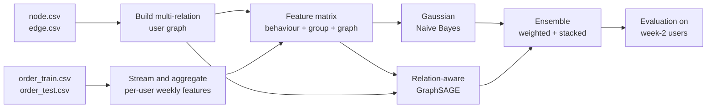

# Promotion Abuse Detection with a GNN + Naive Bayes Ensemble

Detecting users who exploit promotions (coupons, discounts, free offers) on an e-commerce platform, using the **Meituan Public Promotion Abuse (PPA)** dataset.

> College machine learning project. The core idea: abusers look like ordinary customers one at a time, but they are **connected to each other** through shared attributes. A model that sees the graph catches what a single-account model misses.

For a plain-language explanation of the data and the models, read **[concept.md](concept.md)**.

---

## Table of contents

1. [Problem](#problem)
2. [Dataset](#dataset)
3. [Approach](#approach)
4. [Project structure](#project-structure)
5. [Setup](#setup)
6. [Running the notebook](#running-the-notebook)
7. [Configuration](#configuration)
8. [Results](#results)
9. [Limitations](#limitations)
10. [Extending the project](#extending-the-project)
11. [References and credits](#references-and-credits)

---

## Problem

Companies lose money when a few people repeatedly exploit offers meant for new or ordinary customers. A familiar example is a streaming service that gives one free month per user, and one person creating many accounts to get many free months.

This project studies the same pattern on real data: **promotion abuse** on Meituan, one of the largest e-commerce platforms. The task is **node classification**: for each user, predict whether they are an abuser (`1`) or a normal customer (`0`).

Why it is hard:

| Challenge | Why it matters |
|---|---|
| Abusers behave like normal users | Many of their orders are legitimate, so per-account rules fail |
| Extreme class imbalance | Abusers are a tiny fraction of users; plain accuracy is meaningless |
| Fraud is organised in groups | The signal is in the *connections*, not in a single account |
| Data is large | Tens of millions of order lines and millions of users |

## Dataset

**Public Promotion Abuse (PPA)**, released with the PromoGuardian paper.

* Download: <https://osf.io/rasje/>
* Original code: <https://github.com/0xllssFF/PromoGuardian>

Expected local layout (not committed to Git, see [.gitignore](#gitignore-tip)):

```
rasje-osfstorage-archive/
├── node.csv                  # users (nodes), with labels
├── edge.csv                  # connections between users
├── readme.md                 # dataset documentation (read it first!)
└── Transactions/
    ├── order_train.csv       # week 1 orders  -> training / validation
    └── order_test.csv        # week 2 orders  -> testing
```

Order-file columns: `order_time`, `sku_id`, `id` (user), and `r1` to `r8` (the eight relation values per order; empty means not present).

See [concept.md](concept.md) for what each file means and how the graph is built.

## Approach



1. **Graph.** Users are nodes. Edges come from `edge.csv` and are kept **separate per relation type** (up to 8).
2. **Features (no labels used, so no leakage).**
   * Behaviour: number of orders, active days, busiest-day share, distinct products
   * **Group size**: for each relation, how many *other users share the same value*. Abuse rings share values with many accounts
   * Graph structure: degree, per-relation degree, average neighbour degree, neighbourhood averages of the most discriminative features
3. **Model A: Gaussian Naive Bayes** on quantile-transformed features. Fast, simple, hard to overfit.
4. **Model B: relation-aware GraphSAGE** in pure PyTorch. Each layer combines a user's own vector with the mean of its neighbours' vectors, computed per relation.
5. **Ensemble.** Both scores are converted to percentile ranks and blended; the weight is tuned on validation. A stacked logistic-regression variant is also reported.
6. **Evaluation.** Temporal split: train on week 1, test on users who first appear in week 2. Metrics: Precision, Recall, F1, PR-AUC, ROC-AUC, Precision@K.

## Project structure

```
.
├── promotion_abuse.ipynb        # the full pipeline (start here)
├── main.py                      # project entry script (analysis lives in the notebook)
├── pyproject.toml               # dependencies
├── .python-version
├── README.md                    # this file
├── concept.md                   # data + method explained in depth
├── rasje-osfstorage-archive/    # dataset (download separately, not in Git)
└── outputs/                     # created by the notebook
    ├── model_comparison.csv     #   metrics table
    ├── test_predictions.csv     #   score for every test user
    ├── gnn_best.pt              #   trained GNN weights
    ├── naive_bayes.joblib       #   trained NB + feature transformer
    ├── run_config.json          #   settings + detected columns for reproducibility
    └── tx_feat_*.pkl            #   cached order-file features (slow step runs once)
```

## Setup

**Requirements:** Python 3.10+, about 16 GB RAM recommended for large runs (less with sub-sampling), a CUDA GPU is optional.

```bash
git clone <your-repo-url>
cd <your-repo-name>

# using uv (the project already has a pyproject.toml)
uv add torch scikit-learn scipy matplotlib pandas jupyter ipykernel
uv sync

# or using plain pip
python -m venv .venv
source .venv/bin/activate          # Windows: .venv\Scripts\activate
pip install torch scikit-learn scipy matplotlib pandas jupyter ipykernel
```

For GPU training, install the PyTorch build that matches your CUDA version (see <https://pytorch.org/get-started/locally/>). The notebook falls back to CPU automatically.

Download the dataset from OSF, extract it, and place the folder next to the notebook as `rasje-osfstorage-archive/`.

## Running the notebook

1. Open `promotion_abuse.ipynb` in VS Code or Jupyter and select the project's Python environment.
2. **Do a quick first run** by setting these in the Configuration cell:
   ```python
   TX_MAX_ROWS = 2_000_000    # read only part of each order file
   MAX_NODES   = 100_000      # use a smaller subgraph
   ```
3. Run all cells top to bottom. Check the **detected columns table** (section 2): if a column was guessed wrongly, set the matching override (`NODE_ID_COL`, `LABEL_COL`, `EDGE_SRC_COL`, and so on) and re-run.
4. Once it works end to end, set `TX_MAX_ROWS = None` and raise `MAX_NODES` as far as your RAM allows. The first full pass over the order files is slow; results are cached.

## Configuration

| Setting | Default | Meaning |
|---|---|---|
| `MAX_NODES` | `300_000` | Size of the sampled subgraph (`None` = full graph) |
| `PRESERVE_PREVALENCE` | `True` | Keep the real abuser rate in the sample. `False` keeps more abusers but **inflates precision** |
| `TX_MAX_ROWS` | `None` | Limit rows read per order file (for quick tests) |
| `SPLIT_MODE` | `"temporal"` | `"temporal"` (week 1 vs week 2) or `"random"` |
| `HIDDEN`, `N_LAYERS`, `DROPOUT`, `LR` | `64`, `2`, `0.3`, `5e-3` | GNN hyper-parameters |
| `EPOCHS`, `PATIENCE` | `200`, `30` | Training length and early stopping |
| `FORCE_RECOMPUTE_TX` | `False` | Ignore cached order-file features |

## Results

> Fill this table in from `outputs/model_comparison.csv` after your run. Report test-set numbers only.

| Model | Precision | Recall | F1 | PR-AUC | ROC-AUC |
|---|---|---|---|---|---|
| Naive Bayes | | | | | |
| GNN (relation-aware SAGE) | | | | | |
| Ensemble (weighted) | | | | | |
| Ensemble (stacked) | | | | | |

Notes for reading the numbers: PR-AUC of a random model equals the abuser rate, so compare against that baseline, not against 0.5. Thresholds are chosen on the validation set and applied unchanged to the test set.

## Limitations

* The sampled subgraph is thinner than the real graph, so metrics are not directly comparable with the paper's.
* Labels come from reported cases; some undetected abusers are labelled "normal" (label noise).
* Full-batch GNN training does not scale to millions of nodes without neighbour sampling.
* This is a simplified, course-sized model. The published PromoGuardian uses richer spatial and temporal edge features.

## Extending the project

* Add time-aware edge weights and test attention-based GNNs (GAT).
* Tune the decision threshold to a business cost (cost of a lost promotion vs. cost of blocking a real customer).
* Train on the full graph with neighbour sampling.
* Adapt to **free-trial abuse**: replace shared coupon / group with shared device, IP, payment card or email pattern.

## References and credits

* Li, S., Han, X., Zhang, Z., Hua, M., Gao, S., Liang, Z., Guo, Y., Chen, X., Li, D. **PromoGuardian: Detecting Promotion Abuse Fraud with Multi-Relation Fused Graph Neural Networks.** arXiv:2510.12652, 2025. <https://arxiv.org/abs/2510.12652>
* PPA dataset: <https://osf.io/rasje/> (check the OSF page for its license and terms of use before redistributing anything).
* Hamilton, W., Ying, Z., Leskovec, J. *Inductive Representation Learning on Large Graphs (GraphSAGE).* NeurIPS 2017.

This repository contains only original code. The dataset belongs to its authors and is not included.

### .gitignore tip

Do not commit the data or generated artefacts. Add:

```
.venv/
rasje-osfstorage-archive/
rasje-osfstorage-archive.zip
outputs/
__pycache__/
.ipynb_checkpoints/
```
