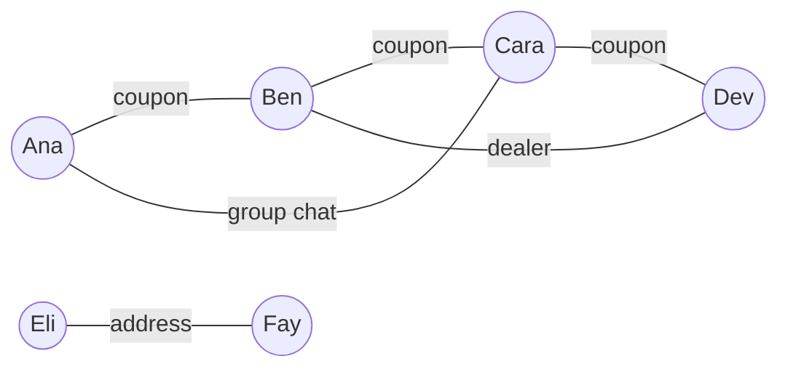

# Concepts: Understanding the Data and How the Project Works

This document explains **what the data is, how it is structured, how the graph is built, and how each model works**, in plain language. Read it before the notebook if the pipeline feels like a black box.

**Confidence legend** (used in the data sections):

| Mark | Meaning |
|---|---|
| ✅ Confirmed | Seen directly in the files or screenshots of this project |
| 🔶 Inferred | Reasonable reading of the evidence; verify against the dataset's `readme.md` |
| ❓ Verify | Not seen yet; the notebook auto-detects it, check the detection table |

---

## 1. The big picture

### 1.1 What is promotion abuse?

A platform runs promotions (discounts, coupons, cashback) to attract ordinary customers. **Promotion abuse** is when people exploit them for profit. The PromoGuardian paper describes two main behaviours:

* **Stocking up:** buying heavily discounted products in bulk, usually to resell.
* **Cashback abuse:** fabricating transactions to claim incentives.

Two things make it different from classic fraud such as stolen cards:

1. **The transactions look legitimate.** The abuser really buys real products; the fraud is the *pattern*.
2. **It is organised in groups.** Accounts that abuse together tend to share things: a group chat, a coupon, a delivery point, a sales-dealer ("header").

So the question is not "is this single order strange?" but **"is this user tied into a suspicious cluster?"**

### 1.2 How it relates to free-trial abuse

Your original idea was someone using many emails to collect many free trials. It is the same structure:

| Free-trial abuse | Promotion abuse (this dataset) |
|---|---|
| Many accounts, one person | Many accounts, one ring |
| Shared device / IP / card | Shared group chat / coupon / dealer / address |
| Looks like normal new signups | Looks like normal shoppers |
| Detect by linking accounts | Detect by linking accounts |

The method here transfers directly; only the relation types change.

---

## 2. Anatomy of the dataset

### 2.1 Files

```
rasje-osfstorage-archive/
├── node.csv            users, one row per user
├── edge.csv            connections between users
├── readme.md           official description (read it!)
└── Transactions/
    ├── order_train.csv   orders from week 1
    └── order_test.csv    orders from week 2
```

The paper describes PPA as **two weeks of anonymised Meituan transactions**, with the **first week used for training and validation and the second week for testing**. The two order files match that exactly. ✅

Reported scale (from the paper's description of PPA): millions of users, eight relation types, tens of millions of edges. 🔶 (Check Table 1 of the paper for exact numbers.)

### 2.2 Order files: `order_train.csv` and `order_test.csv` ✅

Each row is one **order line**. Columns seen in your screenshot:

| Column | Example | Meaning |
|---|---|---|
| `order_time` | `1000-05-25` | Order date. The **year is masked** (always `1000`); only month/day carry information |
| `sku_id` | `39752` | Product identifier (SKU = stock keeping unit) |
| `id` | `53861` | The **user** who placed the order 🔶 |
| `r1` … `r8` | `506103.0`, `NaN` | The user's value for each of the **eight relation types** on that order. `NaN` means that relation does not apply to this order |

Why `id` is a user 🔶: in the tail of your screenshot, user `87040` appears on two rows with identical `r1`, `r3`, `r8` values but different `sku_id`. Values that stay constant across a user's orders are exactly what a user-level attribute looks like.

The dates in your screenshot span `05-22` to `05-28`: one calendar week, consistent with "week 1 / week 2". Each file has roughly 21 million rows. ✅

### 2.3 The eight relations (`r1` … `r8`)

Each `r_k` is an **anonymised identifier** for one kind of shared context. The paper names relation types such as group chat (inside the platform's app), promotion, coupon type, and the sales strategy for offline dealers. 🔶 The mapping of `r1…r8` to those names is *not* visible in the data, so the notebook just calls them `r1…r8`. The dataset's `readme.md` may list the order; if it does, rename them in your report.

Key idea:

> **Two users with the same value in column `r_k` are linked through relation *k*.**

Example (made-up numbers):

| user (`id`) | `r1` | `r3` | `r6` |
|---|---|---|---|
| 101 | 777 | 55 | NaN |
| 102 | 777 | 91 | NaN |
| 103 | 777 | 55 | 12 |
| 104 | 888 | 14 | NaN |

Users 101, 102, 103 share `r1 = 777`, so they are connected through relation 1. Users 101 and 103 also share `r3 = 55`, so they have a second, stronger link. User 104 is isolated here.

### 2.4 `node.csv` ❓ (auto-detected)

Expected role: **one row per user**, containing the user identifier and the **fraud label** (1 = abuser, 0 = normal). It may also hold extra attributes. The notebook looks for an ID column and a label column by name and prints what it chose.

Things to check once you run it:

* Is the ID the same ID space as `id` in the order files? (The notebook warns if no transaction user matches.)
* How are labels encoded, and are some users unlabelled (`NaN`)? Unlabelled users stay in the graph as context but are never used for training or testing.

### 2.5 `edge.csv` ❓ (auto-detected)

Expected role: **pre-computed links between users**. Two layouts are supported:

1. Columns `src`, `dst`, plus **one relation column**, or
2. Columns `src`, `dst`, plus **indicator columns `r1…r8`** (an edge belongs to relation *k* if `r_k` is non-empty / non-zero).

Edges are treated as **undirected** and de-duplicated; how many times a pair is linked is kept as a *multiplicity* (a pair linked many times is a stronger tie).

---

## 3. From tables to a graph

A **graph** has **nodes** (things) and **edges** (relationships between things).

* **Nodes** = users.
* **Edges** = "these two users share something", typed by relation.
* **Node features** = a vector of numbers describing each user (their behaviour and their position in the graph).
* **Node label** = abuser or not (known only for some users).



Ana, Ben, Cara and Dev form a tightly knit cluster linked by several relation types. Eli and Fay share one tie only. The first cluster is far more suspicious: **high cohesion across several relations** is the fingerprint of an abuse ring.

### Why not just use a normal table?

A tabular model sees each user as an independent row. It cannot know that Ben's three friends all abuse coupons. A graph model can pass that information along the edges. That extra context is the whole point of using a GNN.

---

## 4. The train / validation / test split

Because the data covers two weeks, the project uses a **temporal split**, like real deployment:

| Set | Who | Used for |
|---|---|---|
| **Train** | Labelled users active in week 1 (75% of them) | Fitting the models |
| **Validation** | The other 25% of week-1 users | Early stopping, ensemble weight, decision threshold |
| **Test** | Labelled users who appear **only** in week 2 | Final report, touched once |

Why temporal and not random?

* A random split lets the model see a user's near-identical neighbours during training, which flatters the score. A temporal split asks the question that matters in production: *"can a model trained on the past catch the abusers of next week?"*
* Users active in **both** weeks are kept out of the test set so the same person cannot appear on both sides.

Features for a week-2 test user come from `order_test.csv`; features for week-1 users come from `order_train.csv`. No label is ever used to build a feature.

---

## 5. Feature engineering

All features are computed **without labels**.

### 5.1 Behaviour features (from the order files)

| Feature | Intuition |
|---|---|
| `tx_n_orders` | Abusers often order more than ordinary users |
| `tx_active_days`, `tx_day_span` | Concentrated bursts versus spread-out shopping |
| `tx_busiest_day_share` | Share of the week's orders placed on one day |
| `tx_n_skus`, `tx_orders_per_sku` | Buying the same promoted product repeatedly (stocking up) |
| `tx_r{k}_rate` | How often orders carry relation *k* at all |

### 5.2 Group-size features (the strongest signal)

For every relation *k*, take every value the user used and count **how many distinct users used that same value** in the same week.

| Feature | Meaning |
|---|---|
| `tx_r{k}_grp_max` | Size of the biggest group the user belongs to under relation *k* |
| `tx_r{k}_grp_mean` | Average group size across the user's values |
| `tx_r{k}_n_values` | How many different values the user used |

Worked example: coupon value `777` is used by 40 distinct accounts in the week. Every one of those 40 users gets `grp_max = 40` for that relation. A normal user's values are shared by 1 to 3 others. A big number means "this user sits inside a crowd that shares one attribute".

### 5.3 Graph-structure features

| Feature | Meaning |
|---|---|
| `g_degree` | Number of distinct neighbours |
| `g_weighted_degree`, `g_avg_multiplicity` | Total link count; how often the same pair is re-linked |
| `g_n_active_relations` | How many of the 8 relation types the user participates in |
| `g_degree_rel_*` | Degree separately for each relation |
| `g_neighbor_mean_degree` | How well-connected the user's neighbours are |
| `nbr_mean_*` | Average of the **most discriminative features** over a user's neighbours (selected on the training set only) |

### 5.4 Preprocessing

* Count-like columns get `log1p` (`log(1 + x)`), because counts are heavily skewed: most users have 2 orders, a few have 2,000.
* Naive Bayes gets a **QuantileTransformer** (turns any distribution into a bell shape).
* The GNN gets standardised features (mean 0, std 1, clipped at ±5), with the scaler fitted on **training nodes only**.

---

## 6. The models

### 6.1 Gaussian Naive Bayes (Model A)

Naive Bayes asks: *given this user's features, is "abuser" or "normal" more likely?* It uses Bayes' rule and assumes features are independent given the class:

```
log-odds(abuser) = log P(abuser)/P(normal)  +  Σ over features  log p(x_i | abuser) / p(x_i | normal)
```

Each feature votes for or against "abuser", and the votes are added. "Gaussian" means each feature's distribution per class is modelled as a bell curve.

* **Strengths:** very fast, works with few positives, hard to overfit, easy to explain.
* **Weakness:** the "naive" independence assumption is false here (many features are correlated), and it looks at each user alone. The structural and neighbourhood features partly compensate.

The notebook uses the **log-odds** directly instead of probabilities, because Naive Bayes probabilities saturate at exactly 0 or 1 and lose ranking information.

### 6.2 Relation-aware GraphSAGE (Model B)

A **Graph Neural Network** learns a vector for each user by repeatedly **mixing in information from neighbours** ("message passing").

One layer, for user *i*:

```
new_vector(i) = activation( W · [ own_vector(i)  ||  mean of neighbours via relation 1
                                               ||  mean of neighbours via relation 2
                                               ||  ...
                                               ||  mean of neighbours via relation 8 ] )
```

* `||` means "concatenate side by side".
* Neighbours are averaged **separately per relation**, so the network can learn that "shares a coupon with a crowd" differs from "shares a dealer".
* **Two layers** means a user is influenced by neighbours *and neighbours-of-neighbours* (two hops).
* The final layer outputs one number per user: the abuser score.

Training details:

| Choice | Reason |
|---|---|
| **Full-batch** training | Simple; the graph fits in memory after sampling |
| **Class-weighted loss** (`pos_weight` = normal/abuser ratio, capped at 50) | Counteracts the heavy imbalance so the model does not just predict "normal" |
| **Early stopping on validation PR-AUC** | Stops before the model memorises the training users |
| **Dropout 0.3, weight decay** | Regularisation |

Only **features and graph structure** flow through the network. Neighbours' *labels* are never used as inputs, so there is no label leakage.

### 6.3 The ensemble

The two models disagree in useful ways: Naive Bayes is good at per-user behaviour; the GNN adds neighbourhood context.

1. Their raw scores live on different scales, so each is converted to a **percentile rank** (0 to 1) using the validation set as reference.
2. **Weighted soft vote:** `score = w · GNN + (1 − w) · NB`. `w` is chosen on validation. One number to tune means little room to overfit.
3. **Stacked variant:** a small logistic regression learns how to combine the two raw scores. It is fitted on the validation set, so judge it on the test set only.

### 6.4 Choosing the decision threshold

A score is not yet a yes/no decision. For each model the threshold is the value that maximises **F1 on the validation set**, then it is applied unchanged to the test set. (Choosing it on the test set would be cheating.) In a real company you would instead pick it from the business trade-off: the cost of a lost promotion versus the cost of blocking a genuine customer.

---

## 7. Evaluation, and why accuracy is a trap

Suppose the test set has 10,000 users and 100 abusers (1%).

* A model that **always predicts "normal"** is **99% accurate** and catches **zero** abusers.

So the project reports:

| Metric | Question it answers |
|---|---|
| **Precision** | Of the users we flagged, how many were really abusers? (Low precision means angry customers wrongly blocked.) |
| **Recall** | Of all real abusers, how many did we catch? (Low recall means money still lost.) |
| **F1** | Harmonic mean of precision and recall |
| **PR-AUC** | Quality across *all* thresholds; the main metric for rare events. A random model scores about the abuser rate (here 0.01), not 0.5 |
| **ROC-AUC** | Ranking quality across thresholds; can look flattering when positives are rare |
| **Precision@K** | Precision among the K highest-scored users, K = number of real abusers |

Worked example: the model flags 90 users and 72 are real abusers.

```
Precision = 72 / 90  = 0.80
Recall    = 72 / 100 = 0.72
F1        = 2 · 0.80 · 0.72 / (0.80 + 0.72) ≈ 0.76
```

**A warning about sub-sampling.** If `PRESERVE_PREVALENCE = False`, the sample contains a higher share of abusers than reality, which makes precision look better than it would be in production. Report that setting honestly.

---

## 8. How the notebook flows

| Section | What happens | Output to look at |
|---|---|---|
| 0. Setup | Imports, PyTorch/CUDA check, configuration | Device printed |
| 1. Inventory | Lists files, **prints the dataset `readme.md`** | Dataset documentation |
| 2. Load | Reads `node.csv` / `edge.csv`, auto-detects columns | **Detection table (verify it!)** |
| 3. IDs and labels | Unifies IDs, parses labels | Label counts |
| 4. Relations | Encodes edge relations, removes self-loops | Edges per relation |
| 5. Transactions | Streams the two order files, builds weekly per-user features, caches them | Feature summary |
| 6. Sub-sample | Builds a manageable subgraph around random labelled users | Node/edge counts |
| 7. Graph + EDA | De-duplicates edges, degrees, plots | Degree by label |
| 8. Split | Temporal train / validation / test | Split table |
| 9. Features | Combines everything into one matrix | Feature count |
| 10. Naive Bayes | Fit and validate | Validation PR-AUC |
| 11. GNN | Train with early stopping | Loss and PR-AUC curves |
| 12. Ensemble | Choose weight, fit stacker | Weight plot |
| 13. Evaluation | Test metrics, PR curves, confusion matrix | **The results table** |
| 14. Interpretation | Feature effects, top suspicious users, missed abusers | What distinguishes abusers |
| 15. Save | Writes everything to `outputs/` | Files list |

---

## 9. Leakage controls (what to say in a viva)

Data leakage means information from the test set or from labels sneaks into training, inflating scores. This project guards against it:

* **No labels in features.** Neighbour *labels* are never used; only neighbour *features*.
* **Scalers, quantile transformers and feature selection** are fitted on training nodes only.
* **Threshold and ensemble weight** are chosen on validation only.
* **Temporal split**, with users active in both weeks kept out of the test set.
* **Week-specific features:** a test user's features come from the test week.

One honest caveat: the graph is **transductive**. Test users are nodes in the same graph, so their features can flow to training neighbours during message passing. This is standard for node classification, but it is *not* the same as scoring a brand-new unseen user. State this in your report.

---

## 10. Glossary

| Term | Meaning |
|---|---|
| **Node / edge** | A thing / a relationship between two things in a graph |
| **Degree** | Number of neighbours a node has |
| **Relation type** | The kind of connection (here `r1…r8`) |
| **Homogeneous graph** | All nodes are the same type (users); relations are edge types |
| **Message passing** | Each node updates its vector using its neighbours' vectors |
| **GNN / GraphSAGE** | Neural network that learns on graphs by message passing; SAGE averages neighbours |
| **Transductive** | The whole graph, including test nodes, is present during training (labels hidden) |
| **Class imbalance** | One class (abusers) is much rarer than the other |
| **PR-AUC** | Area under the precision-recall curve |
| **Soft vote** | Averaging model scores rather than counting yes/no votes |
| **Stacking** | Training a small model to combine other models' outputs |
| **Data leakage** | Test or label information accidentally used in training |
| **SKU** | Stock keeping unit, a product identifier |
| **Stocking up / cashback abuse** | The two abuse behaviours described in the paper |

---

## 11. Things to confirm with the dataset's own `readme.md`

Before submitting, check these and update the report:

1. The exact names of `r1…r8`.
2. The meaning and encoding of the label column in `node.csv`.
3. Whether `edge.csv` is built from both weeks or one, and how edges were constructed (for example any time or distance windows).
4. Whether `id` in the order files is the same ID space as `node.csv`.
5. The dataset's license and citation requirements.

---

*Source for the dataset and method: Li et al., "PromoGuardian: Detecting Promotion Abuse Fraud with Multi-Relation Fused Graph Neural Networks", arXiv:2510.12652. Dataset: <https://osf.io/rasje/>.*
